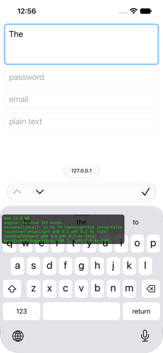
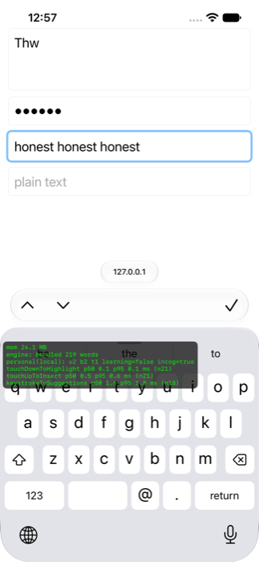

# Keyboard wiring (M2-04 strip wiring, F2/F4 integration)

How the engine (`IBoardEngine`) is connected to the keyboard extension. No new engine features.

## Pieces

- `Packages/IBoardUI/.../TypingCoordinator.swift` (UIKit-free, unit-tested): owns the current word session, turns key
  events into text edits, talks to the engine and the personal learner. Seams: `SuggestionEngine` (adapter
  `EngineBridge` over `EngineActor`) and `PersonalLearning` (`PersonalLearner` conforms as is).
- `iBoardKeyboard/EngineHost.swift`: loads `lexicon.iblex` / `lm.iblm` from the bundle and builds the
  `PersonalStore` + `PersonalLearner`, all in a detached task (no IO or decoding on main). Missing assets: no engine,
  contractions / smart punctuation / learning still work, never a crash.
- `iBoardKeyboard/Resources/lexicon.iblex`, `lm.iblm`: the 219-word synthetic CC0-1.0 fixture from
  `Packages/IBoardEngine/Tests/IBoardEngineTests/Fixtures/small` (built by `Tools/LexiconBuilder`, licences in that
  folder's `licenses.json`). Placeholder until real data (M2-0x).
- `KeyboardViewController`: feeds touches (`trackTouch`) and key events, renders `StripContent` in the 3 slots,
  maps UIKit traits to `FieldConfig` (autocorrection / spell checking / smart quotes / dashes / autocap, `FieldTraits`
  for F4 exclusions), strip taps, DEBUG overlay lines.

## Data flow per keystroke

touch point -> `KeyboardInputMachine` -> `.insert(letter)` -> coordinator resolves the `KeyHit` of the finger that
produced the letter -> inserts the letter -> `EngineActor.beginRequest()` + `submit` on a serial queue ->
`Suggestions` -> strip. `Perf.keystrokeToSuggestions` runs from the key event to the strip update, stale results are
dropped by the engine's sequence number.

## Behaviour

- Strip order: `[literal (quoted if not a word), best, alternative]`; next-word predictions show best in the middle.
- Autocorrect (conservative, `AutocorrectPolicy`) applies on space and `. , ; : ! ? )` only when a result for exactly
  the current word has arrived; otherwise the literal stays. Contractions (`dont` -> `don't`) apply without the engine.
  Never in secure / email / URL / number fields, never when the field says autocorrection off.
- Backspace right after a correction (within 30 s) restores the original, resumes the word session and reports
  `autocorrectReverted`; the second restore of a word puts it on the in-memory never-correct list. Tapping the quoted
  literal counts as the same signal.
- SmartPunctuation: auto-cap (abbreviation aware, replaces `AutoCapitalizer` for shift), double-space period, smart
  quotes / dashes.
- Apostrophe inside a word ends engine tracking for that token; the whole token (`don’t`) is learned, never corrected.
- Learner events: `fieldDidChange` (new `documentIdentifier`, appearance), `wordCommitted` (space, punctuation, strip tap),
  `typingContinued`, `lastWordReopened`, `autocorrectReverted`, `sentenceBoundary` (. ! ? return), `flush`
  (4 s idle, keyboard hidden). Incognito: `iBoard.incognito` in keyboard-local `UserDefaults` (placeholder; DEBUG:
  long-press the top-left corner of the keyboard).
- Storage: `PersonalStorageFactory`: extension-local without Full Access, App Group with it (P-23). The one-way
  local -> App Group migration when Full Access appears is NOT TESTED.

## Verified (iPhone 12 simulator, iOS 27.0, Debug)

- `swift test` in Packages/IBoardUI: 66 tests pass (coordinator with fakes + a real `EngineActor` on the fixture).
- Bundled engine loads ("engine: bundled 219 words"), predictions `Be / The / To` at the start of a text area, typing
  `th` + a touch between `w` and `e` shows `"Thw" / The / They`, space autocorrects to `The `, backspace restores
  `Thw` (screenshots below). Email field: three typed words, learning=false incog=true (automatic), personal counts
  unchanged (u2 b2 t1 before and after).
- Perf on the simulator (Mac CPU, NOT a device number): keystrokeToSuggestions p50 1.6-1.8 ms, p95 1.8-2.3 ms;
  touchUpToInsert p50 0.5 ms. Extension memory 24-25 MB footprint with the tiny lexicon.
- NOT TESTED: real device, Full Access mode, password fields (iOS always shows the system keyboard there, so the
  extension never sees them), strip taps (code path covered by unit tests only), rotation, Duo, the real-size lexicon.

## Caveats and engine hooks wanted

- `Suggestions`, `SuggestionSlot` have internal initialisers: tests cannot build them, hence `EngineResult`/`StripSlot`
  in IBoardUI. Make them public in IBoardEngine and drop the mirror types.
- The engine does not take the personal model: `PersonalStore.scorer()` is not wired into `EngineActor`, so learned
  words do not yet appear in suggestions (needs an engine hook).
- The tap decoder does no transposition (`teh` is not corrected to `the`), only spatial typos.
- Word session starts at the first letter typed after the cursor lands: continuing a word the user did not type this
  session gets no suggestions until a separator.
- A strict exclusivity trap: `shiftActive` must not read the input machine (crashed once, fixed).
- Files needing `xcodegen generate`: `iBoardKeyboard/EngineHost.swift`, `iBoardKeyboard/Resources/lexicon.iblex`,
  `iBoardKeyboard/Resources/lm.iblm`.

## Chips, selection and emoji (M6-03, M6-06, M5-05, M9 wiring)

Strip priority (`KeyboardViewController.renderStrip`): emoji strip > selection banner/action row > backspace delete
preview > chips over suggestions.

**Code chip (M6-03).** `OTPReader` (IBoardOTP) reads the App Group, so it works without Full Access (P-23). Fresh codes
are re-read on appear and every 2 s while visible. `ChipPlanner` (pure, IBoardUI/StripChips.swift): a `oneTimeCode`
field or a number/decimal pad gives up to three emphasised chips from slot 0; any other field gets the newest code in
slot 2. Secure fields get nothing except a one-time-code field. A tap inserts the code with `insertDirect` (never
learned). The keyboard cannot delete from the shared store, so inserted ids are kept in memory
(`consumedCodeIDs`, ids only) and passed to `freshCodes(excluding:)`; the OTP "clear after insert" setting is honoured.
Clipboard fallback (M6-05) is not part of this.

**Personal info chips (M6-06).** `PersonalInfo` / `PersonalInfoReader` / `PersonalInfoWriter` in IBoardUI/PersonalInfo.swift
(IBoardCore was off limits this round). The app writes JSON under App Group key `iBoard.personalInfo`
(`fullName, givenName, familyName, emails, phones, addresses[street, city, region, postalCode]`); the keyboard only
reads. Chips only for `name, givenName, familyName, emailAddress, telephoneNumber, fullStreetAddress,
streetAddressLine1, addressCity, addressCityAndState, addressState, postalCode`, only while the field is empty, never
in secure or untyped fields. The app-side editor is not built.

**Shift + space selection (M5-05).** Only a MANUAL shift arms it (`shiftManual`: auto-capitalisation at a sentence start
must not turn a cursor drag into a selection). `VirtualSelection` (IBoardUI/VirtualSelection.swift) keeps the context
captured at gesture start (before/after halves, grapheme `Character`s), moves the real host cursor with the finger and
returns exact UTF-16 offsets (P-24). Vertical drag jumps hard lines. Strip shows `"...text..." . N chars`, then on lift
the banner on the left and `[Cut][Copy][Delete][Aa][x]` on the right; Cut/Copy are dimmed without Full Access. `Aa`
cycles lower, Title, UPPER by delete + reinsert (the selection stays). A real host selection (`selectedText`, observed
in `textDidChange`/`selectionDidChange`) gets the same row. Typing, return or delete clears the virtual selection.
Limits: selection is bounded by the context the host exposes (<= 500 chars before); cancel (x) leaves the cursor at the
extent end, it does not return to the anchor.

**Emoji (M9-01/02 wired).** Long press (0.45 s) on the 123 key opens `EmojiHost` (iBoardKeyboard/EmojiHost.swift);
the 123 touch-down has already switched layer, so the letters layer is restored on open. The panel covers the key area,
the strip becomes "Search emoji". Tapping the strip starts search: the normal keys type into an in-memory
`EmojiSearchBuffer`, the strip shows `query | hit | hit`, return or the query slot shows all hits in the panel, tapping
a hit inserts it. Panel, catalog and search index exist only while open (`close()`, memory warning, `viewDidDisappear`
drop them). Recents/skin tones live in the extension's own defaults (`iboard.emoji.prefs`), never the App Group.
DEBUG overlay line `emoji: <mode> +X MB (peak +Y)`.

Files needing `xcodegen generate` (project.yml gained the IBoardEmoji package): `iBoardKeyboard/EmojiHost.swift`.
